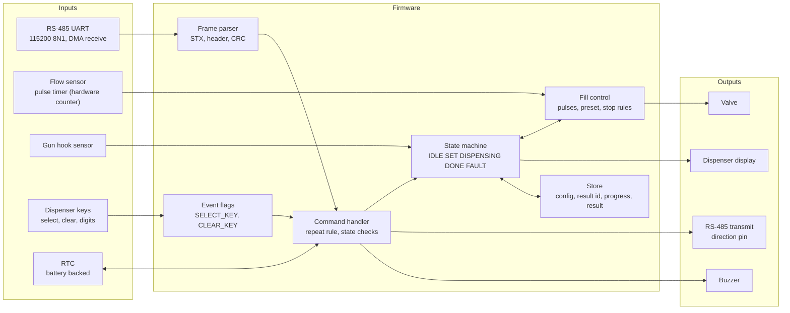
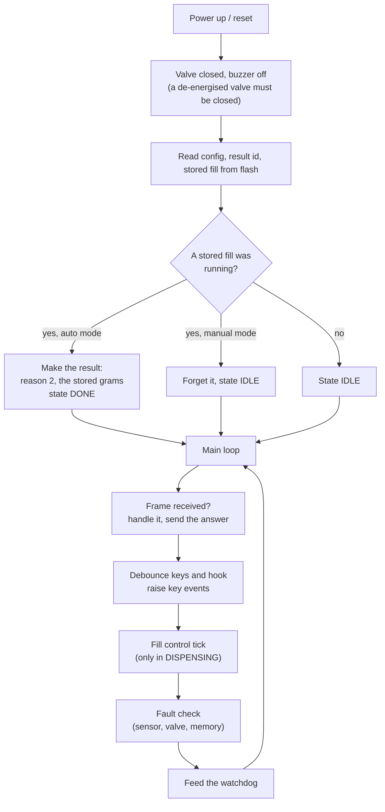
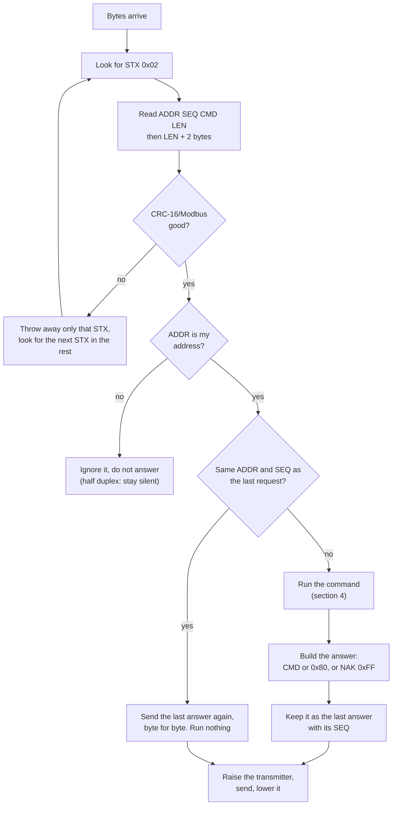
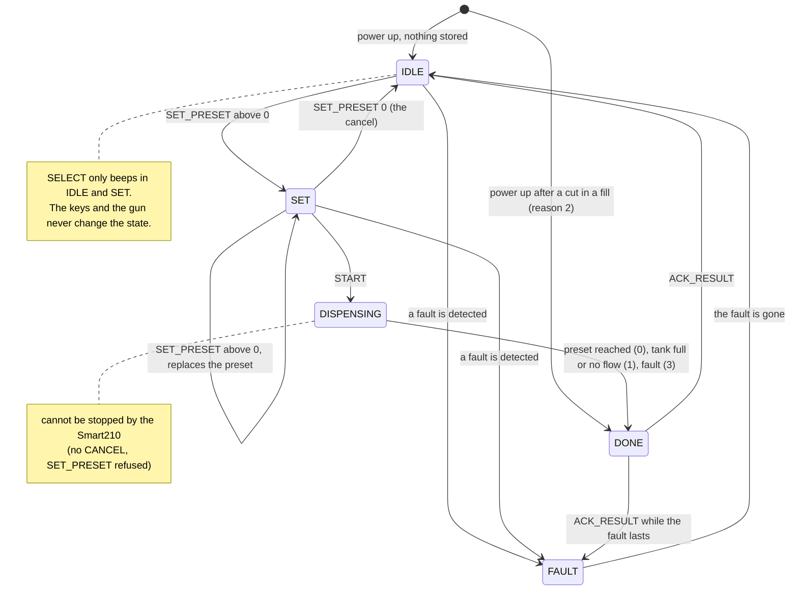
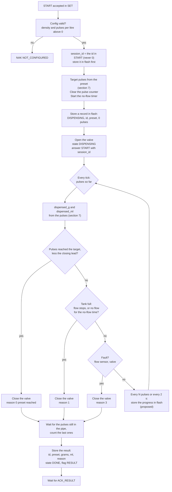
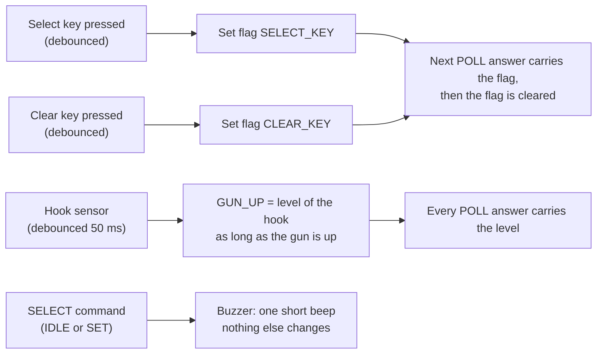
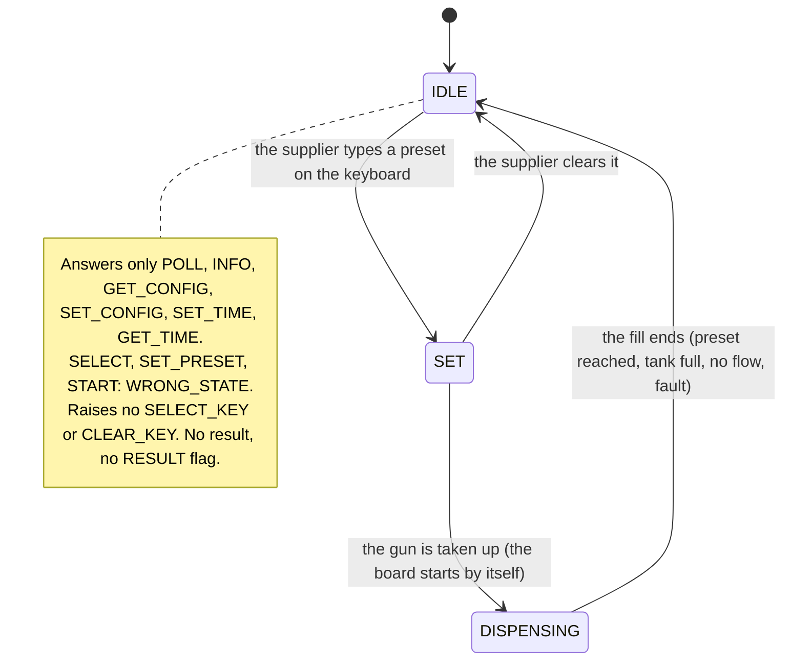
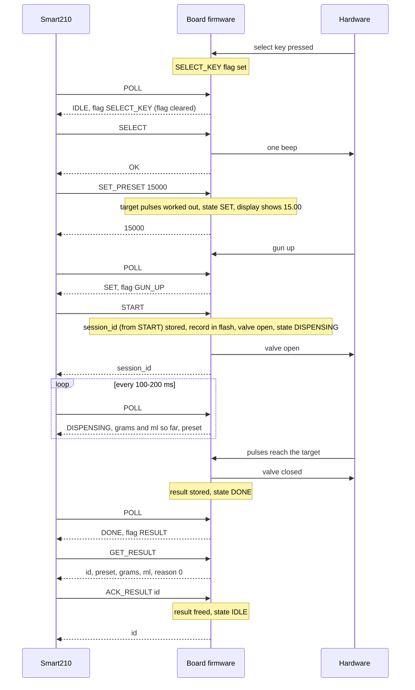

# Nozzle board firmware: logic and diagrams (protocol v0.4)

For the firmware developer (STM32F407, one board per nozzle). It turns [PROTOCOL.md](PROTOCOL.md) into the logic the board runs: the main loop, the frame handler, the state machine, the fill control, the manual mode and the power-up. The reference that already behaves like this is `simulator/src/BoardSimulator.cpp` (the terminal's tests run against it).

What is **fixed by the protocol** is marked as such. What is **proposed** (the protocol does not say, the firmware decides) is marked *proposed*: change it if the hardware says otherwise and tell us.

## 1. The parts of the firmware



Timing that matters (protocol, section 3): the board answers **within 20 ms** of the end of a request, and never speaks first. The master waits 100 ms. So nothing in the request path may block for long: **no flash sector erase inside a request** (an erase of a 128 KB STM32F4 sector takes hundreds of ms). *Proposed:* keep the result id, the progress and the result in a log of pre-erased flash words (or in the battery backed SRAM) and erase a full page in the background when the board is idle.

## 2. Main loop

*Proposed* structure: a super loop plus interrupts, no RTOS needed.



Interrupts: the UART receive (DMA), the pulse counter (hardware timer in external clock mode counts without CPU load), a 1 ms tick for the debounce and the timers.

## 3. The frame handler

Every request goes through this. **Fixed by the protocol:** the CRC, the address check, the repeat rule, the NAK codes.



Rules to keep:

- **Repeat rule:** compare only `SEQ` with the last good request. A repeat sends the stored answer with the same flags. That is what makes START, ACK_RESULT and the key events safe after a lost answer. After a power-up there is no last `SEQ` (the first request is always new).
- **Key events are cleared when their answer has been sent**, not when the POLL arrives: the stored answer already carries the flags, and a repeat sends them again.
- Half duplex: switch the driver on just before the first byte and off after the last byte has left the shift register (transmission complete flag, not the buffer empty flag).

## 4. The command handler

What every command does in every state. **Fixed by the protocol** (NAK codes in section 5 of PROTOCOL.md). A fault is checked first for the commands that would change something.

| Command | IDLE | SET | DISPENSING | DONE | FAULT |
|---|---|---|---|---|---|
| INFO, GET_TIME, SET_TIME, GET_CONFIG | answer | answer | answer | answer | answer |
| POLL | answer | answer | answer | answer | answer |
| SELECT | beep, OK | beep, OK | WRONG_STATE | WRONG_STATE | FAULT |
| SET_PRESET | store, to SET (0 = to IDLE) | replace (0 = to IDLE) | WRONG_STATE | WRONG_STATE | FAULT |
| START | WRONG_STATE | start the fill | WRONG_STATE | WRONG_STATE | FAULT |
| GET_RESULT | NO_RESULT | NO_RESULT | NO_RESULT | result | NO_RESULT |
| ACK_RESULT | OK if the id was just acknowledged, else NO_RESULT | same | same | OK and to IDLE (ID_MISMATCH for another id) | same as IDLE |
| SET_CONFIG | store | WRONG_STATE | WRONG_STATE | WRONG_STATE | WRONG_STATE |

Other checks: wrong `LEN` is BAD_LENGTH; a value out of range BAD_VALUE; START with `density` or `pulses_per_litre` 0 is NOT_CONFIGURED (checked before the state); an unknown command BAD_COMMAND. **Manual mode:** SELECT, SET_PRESET, START are WRONG_STATE; GET_RESULT and ACK_RESULT are NO_RESULT (there is no result).

SET_TIME is accepted in every state and must not disturb a fill.

### POLL answer (19 bytes)

```
state(1)  flags(1)  fault(1)  session_id(4)  dispensed_g(4)  dispensed_ml(4)  preset_g(4)
```

| Field | Value |
|---|---|
| `state` | 0 IDLE, 2 SET, 3 DISPENSING, 4 DONE, 5 FAULT (1 is not used) |
| `flags` | bit0 SELECT_KEY (event), bit2 RESULT (level, state DONE), bit3 FAULT (level), bit4 CLEAR_KEY (event), bit5 GUN_UP (level); bit1 reserved, bits 6-7 free |
| `fault` | 0 none, 1 flow sensor, 2 valve, 3 memory, 4 other |
| `session_id` | the id of the fill while DISPENSING and DONE, else 0 |
| `dispensed_g`, `dispensed_ml` | the fill in progress (0 when idle) |
| `preset_g` | the preset in SET, DISPENSING and DONE, else 0 |

## 5. State machine, auto mode



What changes the state, and what does not:

- **Only commands and the fill itself change the state.** The select key, the clear key and the gun are reported in POLL (SELECT_KEY, CLEAR_KEY, GUN_UP) and nothing else happens on the board. The Smart210 decides: SELECT (beep), SET_PRESET after every scanned ticket, START when the gun is up and tickets are queued, SET_PRESET 0 when the queue was cleared.
- **The board never starts a fill by itself in auto mode** (v0.4). The gun up is only a flag.
- **SET_PRESET** also accepted in IDLE. A preset of 0 is the cancel and the state is IDLE.
- **FAULT:** a fault that appears in DISPENSING ends the fill with reason 3, the result is held, and the board goes to FAULT only after the result is acknowledged (the fault flag is already set in POLL). *Proposed:* a fault in IDLE or SET clears by itself when the sensor reads good again for a few seconds, or with a reset. Please tell us what the hardware can really detect (open point 5 of PROTOCOL.md).

## 6. Fill control

START: **fixed (2026-11-01):** START carries the `session_id` of the fill (4 bytes, made by the Smart210, never 0); the board keeps it with the fill and starts; it never dispenses more than the preset. The board has no counter of its own.



Points the protocol leaves to the firmware (*proposed*):

- **Closing lead.** The valve closes a moment after the command and a few more pulses pass. To keep "never more than the preset", close the valve early by a lead worked out from the flow rate and the valve closing time, and let the last pulses settle before the result is made. If the dispensed weight still ends above the preset by a pulse or two, report what was really dispensed (the Smart210 handles the difference with its tolerance); never hide it.
- **No-flow time** (default 30 s, a config value in the future): the timer restarts at every pulse. The gun put down in the middle of a fill stops the flow and so ends the fill with reason 1 this way. Tell us if the dispenser does something else with the hook.
- **Progress in flash.** The fill in progress must survive a power cut as a result with reason 2. Store `session_id`, the preset and the pulses so far every N pulses or every 2 s. Wear against lost grams is your call (open point 2). The battery backed SRAM of the STM32F407 is an option that needs no flash write at all.
- **Result held until ACK_RESULT**, also after a power cut. ACK_RESULT with the id of the result frees it; with an id it already acknowledged it answers OK and does nothing.

## 7. The arithmetic

Use 64-bit integers; grams and pulses overflow 32 bits in the middle of the calculation. `density` is kg/L x 10000 (8300 = 0.8300), `pulses_per_litre` is x 100.

```c
/* preset in grams -> pulses to reach (PROTOCOL.md section 5, SET_PRESET) */
uint32_t target_pulses(uint32_t preset_g, uint16_t density, uint32_t ppl_x100)
{
    /* litres = preset_g * 10 / density;  pulses = litres * ppl_x100 / 100 */
    uint64_t p = (uint64_t)preset_g * ppl_x100 / ((uint64_t)density * 10);
    return (uint32_t)p;
}

/* pulses so far -> millilitres and grams */
uint32_t ml_of(uint32_t pulses, uint32_t ppl_x100)
{
    return (uint32_t)((uint64_t)pulses * 100000 / ppl_x100);
}
uint32_t grams_of(uint32_t ml, uint16_t density)
{
    return (uint32_t)((uint64_t)ml * density / 10000);
}
```

Check: 15000 g at density 5400 is 27.78 L; at 1234.50 pulses per litre that is 34 291 pulses. Round the target down (never more than the preset).

## 8. Keys, gun and the beep (auto mode)



- Key events are raised **once**, in the answer to the next POLL, in every auto-mode state (the Smart210 decides what they mean). A key pressed twice before a POLL is one event.
- The dispenser's own display shows the preset (SET) and the dispensed weight (DISPENSING, DONE).
- The select key of another nozzle: nothing on this board. The Smart210 sends SET_PRESET 0 to the board that lost the choice.

## 9. Manual mode

Mode 1 in the config. **Fixed by the protocol:** the Smart210 only *watches*. The supplier does everything at the dispenser; the board reports nothing about the end of a fill and holds no result.



- POLL reports the state, the gun (GUN_UP), `preset_g` (in SET and DISPENSING) and the amount so far, so that the Sessions and Dispensers screens of the Smart210 can show the dispenser.
- The fill control of section 6 runs the same way (valve, pulses, stop rules), but when it ends there is no result: the state goes to IDLE, the preset is cleared. Nothing is stored for the Smart210 and no `session_id` is given.
- The protocol says `dispensed_g` and `dispensed_ml` are 0 when idle. (The simulator keeps the last fill's numbers in manual mode until the next one starts; the terminal accepts both.)
- A power cut in a manual fill: the board is IDLE after the restart; nothing is reported.
- The mode changes only with SET_CONFIG, in IDLE, from the Smart210's Machine Config.

## 10. One fill from the board's side

The same exchange as the sequence diagram in PROTOCOL.md section 4, with what happens inside the board at every step.



## 11. Delivery order and the checks

The same order as FIRMWARE_BRIEF.md, with the logic of this document:

1. **Frame parser, CRC, repeat rule** and the answers that need no hardware (INFO, GET_CONFIG, SET_CONFIG, GET/SET_TIME). Check with the hex examples in PROTOCOL.md section 7 and the simulator's frames.
2. **State machine and presets with simulated pulses** (no valve): the terminal's whole start / result flow works against the board on a bench. Use the command table of section 4 as a test list.
3. **Real flow sensor, valve, hook, keys**; calibrate pulses per litre from the terminal's Machine Config.
4. **Power cut and faults;** then the bench test with a real dispenser (work plan 6.6).

Bench checks (the same four as in PROTOCOL.md): (a) scan, preset on the display, gun up, START, fill to the preset, result, ACK; (b) the clear key and then the gun up with an empty queue: no START, preset zero, IDLE; (c) the select key of another nozzle: the first nozzle gives its preset back (SET_PRESET 0); (d) a manual board: preset typed, gun up, fill, nothing reported afterwards, the Smart210 sends nothing but POLL and SET_TIME.

Also check by hand: a lost answer (the same `SEQ` twice) for START, ACK_RESULT and a key event; a power cut in a fill (result with reason 2 and the stored grams); a fault in a fill (reason 3, then FAULT after the ACK).
