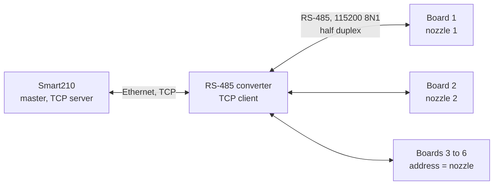

# Nozzle board protocol v0.4 (draft)

Between the Smart210 (master) and one STM32F407 board per nozzle (slave). **Status 2026-11-04:** the reference firmware (`firmware/`) and the board simulator (`simulator/`) both implement this file, and the Smart210 driver follows it; this is the file the firmware developer gets (work plan 0.5). Nothing has run on a real board yet (bench test 6.6). The additions since v0.3 are collected in section 11.

**v0.4 (draft, to be agreed with the firmware developer):** the board never starts a fill by itself: the **gun** (the hook of the nozzle) is reported in POLL (flag GUN_UP, bit5, a level) and the Smart210 answers with START when tickets are queued; the keys of the dispenser only report themselves in POLL while the Smart210 answers with commands (the select key with SELECT: the board beeps and nothing else changes, the choice of the nozzle is kept by the Smart210); there are four nozzle states (IDLE, SET, DISPENSING, DONE) and no DESELECT or CANCEL command: a preset of zero is the cancel. Everything else is as in v0.3.

### Changes from v0.3 (the checklist for the firmware developer)

Please confirm each line (or say what you want instead). The Smart210 app, the test board (`simulator/`) and the end-to-end tests already follow all of it.

| # | Change | Board side | Where |
|---|---|---|---|
| 1 | **Four states**: IDLE (0), SET (2, was ARMED), DISPENSING (3), DONE (4, was RESULT); value 1 (SELECTED) is not used; FAULT (5) stays | no "selected" state | section 4 |
| 2 | **POLL answer has `preset_g`** (19 bytes): state, flags, fault, session_id, dispensed_g, dispensed_ml, preset_g | add 4 bytes | section 5, example in 7 |
| 3 | **GUN_UP**, POLL flag bit5, a level: set as long as the gun is up | read the hook sensor | section 5 |
| 4 | **The board never starts a fill by itself in auto mode**: the gun is reported, the Smart210 sends START (when tickets are queued and the preset is on the board) | START as before; no start by the gun | section 6 |
| 5 | **Keys only report**: SELECT_KEY (bit0) and CLEAR_KEY (bit4) are events raised once in the next POLL answer, the state does not change; bit1 is reserved | no state change on a key | section 5 |
| 6 | **SELECT** (to the board's own address) only makes the board **beep**; its state does not change; accepted in IDLE and SET, refused while dispensing. The choice of the nozzle is kept by the Smart210 | beep | section 5 |
| 7 | **No DESELECT (0x04) and no CANCEL (0x07)**: SET_PRESET with `preset_g` = 0 in IDLE or SET is the cancel (state IDLE); refused while dispensing | remove two commands | section 5 |
| 8 | **SET_PRESET is accepted in IDLE** as well as in SET | state IDLE accepted | section 5 |
| 9 | **Manual mode**: the board only answers POLL, SET_TIME / GET_TIME and the config commands (GET_CONFIG, SET_CONFIG, INFO); the supplier types the preset on the dispenser, takes the gun up, and the board runs and ends the fill by itself; it reports **no keys**, **no end of a fill**, holds **no result** (back to IDLE); SELECT, SET_PRESET, START refused with WRONG_STATE | simplify | section 5 (Modes) |
| 10 | **INFO answers `protocol` = 4** | one number | section 5 |
| 11 | **SHOW_BALANCE (0x0E), new on 2026-11-01**: the Smart210 asks the dispenser to show a number, the balance of a customer's card, so that the customer can confirm it before a fill with a card; it arms nothing (no preset, state stays IDLE) | one command and its display | section 5 |
| 12 | **GET_TOTAL (0x0F) and RESET_TOTAL (0x10), new on 2026-11-03**: the board keeps the total of everything it has dispensed (the Total key of the dispenser shows it); the Smart210 reads it and a technician resets it on Machine Config | two commands | section 5 |
| 12 | **Session id, new on 2026-11-01**: START carries a `session_id` (4 bytes, made by the Smart210); the board keeps it in flash with the fill and its result and sends it back as the `session_id` of POLL (while a fill runs or a result is held), of GET_RESULT and of the START and ACK_RESULT answers. The board **no longer has a counter of fills**: what was `result_id` is the Smart210's `session_id` | START data (4 bytes) kept with the result; no counter in flash | section 5 |

Behaviour to check on the bench: (a) scan, preset on the display, gun up, START, fill to the preset, result, ACK; (b) the clear key and then the gun up with an empty queue: no START, preset zero, IDLE; (c) the select key of another nozzle: the first nozzle gives its preset back (the Smart210 sends SET_PRESET 0); (d) a manual board: preset typed, gun up, fill, nothing reported afterwards, the Smart210 sends it nothing but POLL and SET_TIME.

## 1. Link

- The Smart210 is the TCP **server**: it listens on a port (set on Machine Config). The RS485-to-Ethernet converter is set to TCP **client** mode with the Smart210's address and that port, and connects by itself, and again after every drop or restart. The converter passes bytes through as they are. One converter link is used: when a new connection arrives it replaces the old one (the old link is then dead).
- RS-485 side: 115200 baud, 8N1, half duplex, 10-15 m, terminated at both ends.
- The Smart210 turns TCP no-delay on and flushes every request at once; the converter should not hold bytes back either.
- Several boards (addresses 1-247) may share one converter. The Smart210 is the only master: it sends one request and waits for the answer before sending the next, so the bus is never driven by two parties. A board never speaks unless it is asked.
- Nothing is broadcast. Address 0 and 248-255 are not used.



## 2. Frame

```
STX  ADDR  SEQ  CMD  LEN  DATA[LEN]  CRC_LO  CRC_HI
0x02  1     1    1    1    0..64       1       1
```

- `ADDR`: the board address, in the request and in the answer.
- `SEQ`: chosen by the master, copied into the answer. It changes (wraps 0-255) after every good answer; until then the same value is repeated (see 3).
- `CMD`: the command in a request. The answer carries `CMD | 0x80`. An error answer carries `0xFF` (see 5).
- `LEN`: number of data bytes, 0-64.
- `CRC`: CRC-16/Modbus (polynomial 0xA001 reflected, start 0xFFFF, no final xor) over `ADDR SEQ CMD LEN DATA`, sent low byte first. Check value: CRC of the ASCII text `123456789` is `0x4B37`.
- All numbers inside DATA are unsigned and little-endian.
- Receiver rule: look for `STX`, read the header, wait for `LEN + 2` more bytes, check the CRC. When the CRC is wrong, throw away only that `STX` and look for the next one in the remaining bytes (`0x02` can also appear inside a frame). A frame that is not complete when the master's 100 ms answer wait ends is dropped (the master also throws away whatever is left in its buffer before each new request, so a late or half answer never mixes with the next one).

## 3. Polling and lost answers

There are no immediate retries. The polling cycle is the retry.

- The Smart210 goes round the boards in turn, one request per board per cycle, one at a time (about every 100-200 ms for a board). A board gets the command waiting for it, or a POLL when there is none.
- The board answers within 50 ms (usually 20 to 30 ms: the main loop of the board takes about 30 ms a pass while it serves its displays; the bytes of a request wait in a ring until the loop comes round). The master waits at most 100 ms for the answer. A wrong CRC, a short frame or no answer is simply dropped and the master moves on to the next board.
- **`SEQ` rule:** the master changes `SEQ` only after a good answer. Until then the next request to that board repeats the same `SEQ` (and, if a command was waiting, the same command), so a lost answer costs one cycle and nothing else.
- When the master gives a command up (the board went offline while it waited), it moves `SEQ` on, so the next request is a new one and not a repeat of the old command.
- **Repeat safety:** a board that gets the same `ADDR` and `SEQ` twice in a row does not carry out the command again; it sends its last answer again, with the same keypad flags. That makes START, ACK_RESULT and the key events safe to repeat after a lost answer.
- A board that gave no good answer in 3 cycles in a row is shown as offline. It is still tried, but only once every 2 s, so a dead board does not slow the others. The first good answer brings it back.

## 4. Board states

| Value | State | Meaning |
|---|---|---|
| 0 | IDLE | Nothing selected |
| 1 | (not used) | v0.4: the board has no "selected" state; which nozzle is chosen is kept by the Smart210 |
| 2 | SET (ARMED) | The preset is loaded (the dispenser shows it), waiting for START |
| 3 | DISPENSING | The fill runs; it cannot be stopped from the Smart210 |
| 4 | DONE (RESULT) | The fill ended; the result waits for ACK_RESULT |
| 5 | FAULT | The board cannot work (sensor or flow fault); `fault` in POLL says why |

```
IDLE --SET_PRESET--> SET(ARMED) --START--> DISPENSING --end--> DONE(RESULT) --ACK_RESULT--> IDLE
SET --SET_PRESET with zero--> IDLE        (the cancel; only before the fill starts)
The gun taken up (hook) is only reported: POLL flag GUN_UP (bit5, a level, as long as the gun is up). The Smart210 sends START when the gun is up, the board is SET and tickets are queued; with the queue cleared it sends no START and sets the preset to zero.
SELECT (any time but DISPENSING / DONE): the board only beeps, its state does not change
The keys of the dispenser (select, clear) never change the state
```

**One fill, auto mode** (v0.4; a solid arrow is a request from the Smart210, a dashed arrow is the board's answer; the board's state after the answer is in the notes). The supplier presses the select key of the nozzle (the board only reports it in its next POLL answer with SELECT_KEY; the Smart210 answers with SELECT) and scans tickets: the Smart210 sends the preset again after every scan. The supplier takes the gun up: the board starts by itself. Every request is one exchange of the polling cycle (section 3); a lost answer is repeated with the same `SEQ`.

```mermaid
sequenceDiagram
    participant S as Smart210
    participant B as Nozzle board
    Note right of B: the select key is pressed (only reported)
    S->>B: POLL
    B-->>S: flag SELECT_KEY, state IDLE
    S->>B: SELECT (address of this board)
    B-->>S: OK, the board beeps
    Note right of B: the board only beeps; the Smart210 keeps the choice
    S->>B: POLL
    B-->>S: state IDLE
    Note left of S: a ticket is scanned
    S->>B: SET_PRESET (total of the queue)
    B-->>S: the same preset
    Note right of B: ARMED, the dispenser shows the preset
    Note left of S: another ticket: SET_PRESET again
    Note right of B: the supplier takes the gun up: the board reports GUN_UP in its POLL answers
    S->>B: POLL
    B-->>S: flag GUN_UP, state SET
    S->>B: START with the session_id (tickets are queued, the preset is on the board)
    B-->>S: session_id of the new fill
    loop every 100-200 ms
        S->>B: POLL
        B-->>S: DISPENSING, session_id, grams and ml so far
    end
    Note left of S: DISPENSING seen: the session is saved, the queue is locked
    S->>B: POLL
    B-->>S: flag RESULT (the fill ended)
    Note right of B: RESULT
    S->>B: GET_RESULT
    B-->>S: session_id, preset, dispensed g and ml, reason
    Note left of S: the supplement is saved first
    S->>B: ACK_RESULT (session_id)
    B-->>S: session_id (the board forgets the result)
    Note right of B: IDLE
```

The fill stops by itself when the preset is reached, when the tank is full or when no flow is seen for the no-flow time. The board never gives more than the preset. A power cut in DISPENSING comes back as state RESULT with `reason = 2` (see GET_RESULT) holding the last value it stored.

## 5. Commands

| Code | Name | Request DATA | Answer DATA |
|---|---|---|---|
| 0x01 | INFO | - | `protocol`(1) = 4, `fw_major`(1), `fw_minor`(1), `serial`(4) |
| 0x02 | POLL | - | `state`(1), `flags`(1), `fault`(1), `session_id`(4), `dispensed_g`(4), `dispensed_ml`(4), `preset_g`(4) (v0.4: 19 bytes; the status of the dispenser: state, gun and keys in `flags`, the preset, the amount dispensed) |
| 0x03 | SELECT | - | empty (v0.4: the board beeps; its state does not change) |
| 0x05 | SET_PRESET | `preset_g`(4) | same as the request |
| 0x06 | START | `session_id`(4) | `session_id`(4) |
| 0x08 | GET_RESULT | - | `session_id`(4), `preset_g`(4), `dispensed_g`(4), `dispensed_ml`(4), `reason`(1) |
| 0x09 | ACK_RESULT | `session_id`(4) | `session_id`(4) |
| 0x0A | GET_CONFIG | - | the config: `mode`(1), `fuel_type`(4), `density`(2), `pulses_per_litre`(4) |
| 0x0B | SET_CONFIG | the config (same 11 bytes) | the config as stored |
| 0x0C | SET_TIME | `year`(2), `month`(1), `day`(1), `hour`(1), `minute`(1), `second`(1) | same as the request (the time now stored) |
| 0x0D | GET_TIME | - | the board's clock now, same 7 bytes |
| 0x0E | SHOW_BALANCE | `value_g`(4) | same as the request |
| 0x0F | GET_TOTAL | - | `total_g`(8): every gram the board has dispensed since the last reset, little endian |
| 0x10 | RESET_TOTAL | - | `total_g`(8): the total **before** the reset; it is 0 now and stays 0 over a power cut |
| 0xFF | NAK (answer only) | - | `error`(1), `cmd`(1) = the command that failed |

Details:

- **POLL** `flags`: bit0 SELECT_KEY (the supplier pressed the select key of the dispenser), bit1 reserved (was DESELECT_KEY), bit2 RESULT (a result is waiting; same as state 4), bit3 FAULT (same as state 5), bit4 CLEAR_KEY (v0.4: the supplier pressed the clear key of the dispenser). Bits 0, 1 and 4 are events: the board raises them once, in the answer to the next POLL, and clears them when that answer has been sent (a repeated POLL with the same `SEQ` gets the same flags again). Bits 2-3 are levels. `fault`: 0 none, 1 flow sensor, 2 valve, 3 memory, 4 other. `session_id` is 0 unless a fill runs (the id of that fill) or a result waits. `dispensed_g` and `dispensed_ml` count the fill in progress (0 when idle).
- **Select key and the SELECT command (v0.4).** The nozzle board has the states IDLE, SET, DISPENSING and DONE; it has **no selected state**. The key of the dispenser does not change the state: when the supplier presses it the board only reports the key code in its next POLL answer (SELECT_KEY, CLEAR_KEY, ...). When the Smart210 gets a select key event it makes that nozzle the current one in **its own state** (one nozzle at a time: the one chosen last) and sends the **SELECT command** to that board's address. The board **beeps** for the selection and nothing else happens: its status is not updated, and its next POLL answer reports the same state as before. Pressing the select key of the current nozzle again lets it go in the Smart210 (no command). The tickets the supplier scans go to the queue of the current nozzle, and the Smart210 sets the preset on that board (SET_PRESET).
- **SET_PRESET** (IDLE or SET): a preset of 0 is the cancel (see below), the state is IDLE. Otherwise `preset_g` is the weight to dispense in grams (1 kg = 1000, max 4 294 967 295). The board turns it into the pulse count it must reach with its own config: `litres = preset_g x 10 / density` (15000 g at density 5400 is 27.78 L), `pulses = litres x pulses_per_litre / 100`. Sending it again replaces the old preset. State becomes ARMED.
- **START** (SET): the request carries the `session_id` of the fill (4 bytes, made by the Smart210, never 0: BAD_VALUE; any other length is BAD_LENGTH). The board **keeps it in flash with the fill and its result** and starts; the answer repeats it. The board has no counter of its own for fills: the id is the Smart210's. A START repeated in DISPENSING with the same `SEQ` gets the same answer; with a new `SEQ` it is refused (WRONG_STATE).
- **There is no CANCEL command (v0.4).** A preset of zero is the cancel: SET_PRESET with `preset_g` = 0 in IDLE or SET drops the preset and the state is IDLE. In DISPENSING it is refused (WRONG_STATE). Use the dispenser's own emergency stop for an emergency.
- **GET_RESULT** (RESULT only): `dispensed_g` is the weight the board calculated from the pulses and the density; `dispensed_ml` is the volume. `reason`: 0 preset reached, 1 tank full or no flow, 2 interrupted (power cut or reset), 3 fault.
- **ACK_RESULT**: the board forgets the result and goes to IDLE. The id must be the one it holds; for an id it already acknowledged it answers OK without doing anything (so a lost answer can be repeated). The Smart210 sends it only after the result is saved in its own database.
- **GET_TOTAL / RESET_TOTAL** (v0.4 + 2026-11-03): the board adds the grams of every fill to a total when the fill ends (both modes; a fill cut by a power cut adds what its last save of the count had) and keeps it in its memory. GET_TOTAL answers it in any state; RESET_TOTAL sets it to 0, saves it and answers the value it had. RESET_TOTAL is refused with WRONG_STATE while a fill runs (DISPENSING), with FAULT in FAULT, and with BAD_LENGTH when `LEN` is not 0. Both are answered by a manual board too (they are service commands, like the config). A repeated RESET_TOTAL after a lost answer answers 0, so the Smart210 reads the total first (GET_TOTAL) and shows that value. `INFO` `fw_minor` = 2 from a board that knows them; an older board answers BAD_COMMAND.
- **SHOW_BALANCE** (v0.4 + 2026-11-01, IDLE only): shows `value_g` on the dispenser's display, in grams as kg with two decimals, the way a preset is shown (15000 shows 15.00); the dispenser should also show that this is a balance and not an amount to dispense, if it can (a lamp or a "bAL" text). It is **not** a preset: the board stays IDLE, `preset_g` in POLL stays 0, and a gun taken up changes nothing (the Smart210 never answers it with START). The number stays until the next SET_PRESET (which shows the preset), until SHOW_BALANCE with `value_g` = 0 (clears the display), or for 60 seconds, then the display goes back to what it shows when idle (the Smart210 sends the number again if the customer needs more time). Refused with WRONG_STATE in SET, DISPENSING, DONE and in manual mode, with FAULT in FAULT, with BAD_LENGTH when `LEN` is not 4, and with BAD_VALUE when the number has more digits than the display can show. A SET_PRESET or a SET_PRESET with zero clears the shown balance too. Used by the card supply of the Smart210: the cashier reads the card and the PIN, the dispenser shows the balance (SHOW_BALANCE), the customer confirms it, the cashier types the amount (SET_PRESET) and the supplier fills.
- **Time** (new in v0.3): the Smart210 is the one source of time at the station. It sends SET_TIME with its local date and time (the station's own time zone, no daylight saving) when a board comes online, then every hour, and after its own clock was corrected from the server. The board sets its clock, answers with the time stored and keeps it running (a battery-backed RTC is wanted, so that it also survives a power cut). SET_TIME is accepted in every state, also while a fill runs, and must not disturb the fill. A date or time that does not exist is refused with BAD_VALUE, a wrong length with BAD_LENGTH. GET_TIME answers the board's clock (for a check; the Smart210 does not need it). A v0.2 board that does not know the two commands answers BAD_COMMAND once and the Smart210 leaves it alone: the commands are an addition and change nothing else. `INFO` answers `protocol` = 3 from a v0.3 board and 4 from a v0.4 board.
- **Config** (what a nozzle board holds, in flash; SET_CONFIG only in IDLE). GET_CONFIG answers it and SET_CONFIG stores it and answers with what is stored, so the Smart210 always shows what the board really has.
  - `mode`: 0 auto, 1 manual (see "Modes" below). It decides who sets the amount of a fill.
  - `fuel_type`: the fuel type code of the nozzle, up to 4 ASCII characters, padded with 0 bytes (`D` is `44 00 00 00`). It is the same code as in the web app's fuel types.
  - `density`: kg per litre x 10000 (0.8300 kg/L = 8300), range 1000-20000.
  - `pulses_per_litre`: x 100 (1234.50 pulses = 123450), range 1-100 000 000.
  - SET_CONFIG with a value out of range or an empty fuel type is refused with BAD_VALUE (nothing is stored); in any state but IDLE with WRONG_STATE. A board that was never configured has `density` or `pulses_per_litre` 0: START is then refused with NOT_CONFIGURED.

### Modes

- **Auto (0):** the amount comes from the Smart210. The supplier scans the ticket barcodes with the scanner, the Smart210 sums the weight and sends it to the selected nozzle (SELECT, SET_PRESET, START); the board dispenses to that preset.
- **Manual (1) (v0.4):** the board is a dispenser the Smart210 only **watches**. The supplier types the preset on the dispenser's own keyboard and takes the gun up, and the board starts, runs and ends the fill by itself. It answers **POLL** with the status of the dispenser (state, `flags` with the gun, `preset_g`, `dispensed_g`, `dispensed_ml`, ...), SET_TIME / GET_TIME and the config commands (GET_CONFIG, SET_CONFIG, INFO). It **does not report keys** (no SELECT_KEY, CLEAR_KEY), **does not report the end of a fill** and holds no result (no RESULT state, no GET_RESULT / ACK_RESULT), and it ignores SELECT, SET_PRESET and START (they are refused with WRONG_STATE). The Smart210 does not work with its dispensing at all: nothing is read, acknowledged, recorded or kept. The mode changes only with SET_CONFIG (in IDLE), from Machine Config.
- The mode changes only with SET_CONFIG (in IDLE), from Machine Config.

### NAK error codes

| Code | Name | When |
|---|---|---|
| 1 | BAD_COMMAND | Unknown `CMD` |
| 2 | BAD_LENGTH | Wrong `LEN` for the command |
| 3 | WRONG_STATE | The command is not allowed in the current state |
| 4 | BAD_VALUE | A value out of range |
| 5 | NOT_CONFIGURED | START with `density` or `pulses_per_litre` still 0 |
| 6 | NO_RESULT | GET_RESULT / ACK_RESULT with nothing waiting |
| 7 | ID_MISMATCH | ACK_RESULT with another `session_id` than the one held (the id the fill was started with) |
| 8 | FAULT | The board is in FAULT |

## 6. What the Smart210 does with it

- The nozzles are the boards 1 to N (N is a constant in the program, 6 for now): nozzle number = board address. The Smart210 asks each board that answers for its config (GET_CONFIG) and keeps what it reports as the nozzle's settings. Machine Config shows every nozzle with its status and config. A change made there is sent to the board (SET_CONFIG); the boards' clocks are kept right with SET_TIME (section 5, Time); the answer, and a GET_CONFIG after it, bring back what the board stored and that is what the Smart210 keeps. Machine Config also stores the port the Smart210 listens on for the converter, and the tank of each nozzle (the board does not know tanks).
- A supply session is saved locally (queue of tickets, preset, nozzle) before START. The id of the session (a number the Smart210 makes, each one above the one before) is saved with it and sent to the board with START; the board keeps it with the fill, reports it in POLL while the fill runs or a result is held, in GET_RESULT and in the answer of ACK_RESULT. When a result is read (GET_RESULT) the supplement is saved first, with that `session_id` (a result whose id is not the one of the nozzle's saved session is saved without the queue, and a second result with an id that is already recorded is the same fill), and only then ACK_RESULT is sent with the same id. After a crash or reconnect the Smart210 polls, sees state RESULT or a running fill and carries on with the saved session.
- **The supplier works at the dispenser (v0.4).** The Smart210 does not start anything by itself. The supplier presses the select key of a nozzle: the board reports it (SELECT_KEY), the Smart210 makes the nozzle the current one and sends SELECT (the board beeps; see "Select key" in section 5). The supplier scans the tickets; after every change of the queue the Smart210 sends SET_PRESET with the queue's total to the current nozzle (state IDLE or SET; the board's display shows it). When the supplier takes the gun up the board only reports it (GUN_UP in POLL). The Smart210 checks: with tickets queued and their preset on the board (SET) it saves the session (queue, preset) and sends START (the answer carries the `session_id`), and the queue is locked; if the queue was cleared it sends no START and sets the preset to zero. The clear key of the dispenser is reported (CLEAR_KEY); the Smart210 drops the queue and, when the board is SET, sends SET_PRESET with zero so that the board forgets its preset (IDLE) (not once the fill runs). A fill paid with a card is started the same way by the Smart210 (SET_PRESET, then START).
- If a board cannot be read at all (not answering, fault) after a fill that was started from the app, the cashier types the reading in on the Manual input screen; that supplement is marked `manual` and takes the tickets (or the card) of the started fill.
- In manual mode (see Modes) the Smart210 only polls the board (the Sessions and Dispensers screens show its status, preset and dispensed amount) and records nothing. The cashier types the supply in on the Manual input screen with its tickets, which must cover the dispensed weight and may exceed it by 0.05 kg at most (the tolerance only ever favours the station), so a manual supply has no remainder. An auto fill that stops early (`reason` 1, 2 or 3) gives a remainder ticket for the tickets' weight minus `dispensed_g`; at `reason` 0 a rest of 0.05 kg or less is ignored.

## 7. Examples (hex)

Board 1, `SEQ` 5, POLL request:

```
02 01 05 02 00 10 B9
```

Answer: DISPENSING, no flags, no fault, `session_id` 42, 12500 g so far, 23148 ml so far, preset 15000 g:

```
02 01 05 82 13 03 00 00 2A 00 00 00 D4 30 00 00 6C 5A 00 00 98 3A 00 00 CC 8D
```

Board 2, `SEQ` 6, SET_PRESET 15000 g:

```
02 02 06 05 04 98 3A 00 00 59 2A
```

Board 1, `SEQ` 7, SET_TIME 2026-10-10 09:30:15 (the answer has `CMD` 0x8C and the same data, `02 01 07 8C 07 EA 07 0A 0A 09 1E 0F 8E E4`):

```
02 01 07 0C 07 EA 07 0A 0A 09 1E 0F EF 22
```

Board 3, `SEQ` 9, SET_CONFIG: auto, fuel type `D`, density 0.8300, 1234.50 pulses per litre (the answer has `CMD` 0x8B and the same data):

```
02 03 09 0B 0B 00 44 00 00 00 6C 20 3A E2 01 00 93 33
```

Board 2, `SEQ` 7, NAK WRONG_STATE for command 0x06 (START):

```
02 02 07 FF 02 03 06 A5 1F
```

## 8. Open points for the firmware developer

1. Is 115200 baud with the converter's transparent mode fast enough with your board count? (A 22-byte answer takes about 2 ms on the wire; ten boards are polled in well under 100 ms.)
2. The no-flow time (default 30 s) and how often the fill in progress is stored in flash for the power-cut case.
3. Whether the keypad needs more keys than select; if so more flag bits are free (bits 4-7).
4. Manual mode (see Modes): the board needs its own keyboard entry of the amount, a way to start by itself, and it must still keep the result until ACK_RESULT. Is a power cut in the middle of a manual fill handled the same way (RESULT with `reason` 2)?

## 9. How the first firmware answers the open points (firmware v1.0, 2026-10-11)

1. Speed: not measured yet (bench test, work plan 6.6).
2. No-flow: a fill ends with reason 1 when no flow count comes for 30 s **after the first count**; when the nozzle has been on its hook for 3 s after the flow began; or when no count comes within 10 minutes of START (the nozzle was never lifted). The pump runs only while the nozzle is lifted. The fill in progress is written to the flash every 2 s while counts change, and at once when the POWER_OFF input goes high.
3. Keys: the keyboard has 17 keys (0 to 9, Dot, Next, Prev, Total, Clear, Set, Function). Function is the select key; Clear is reported; in manual mode the digits, Dot, Clear and Set type and take the amount; Total shows the total dispensed (both modes); Next and Prev are not used; no more flag bits are used.
4. Manual mode: a power cut in the middle of a manual fill gives a result with reason 2, as in auto mode. (Replaced in section 10: a manual board holds no result, the fill is dropped.)
5. Flow meter: two-phase A/B, all four edges counted, so `pulses_per_litre` is in counts; a backflow takes counts off again. A fill that reaches its preset reports exactly the preset as `dispensed_g` (the calibration decides what was dispensed); a fill that stops early reports what the counts say, never more than the preset. Faults: 1 and 2 are raised by the hardware code through `board_set_fault()` (none is detected yet), 3 when the flash refuses or is unreadable, 4 other; a fault goes away when the hardware code clears it.
6. Firmware update: not designed yet.

## 10. The firmware follows v0.4 (firmware v1.1, 2026-11-03)

`firmware/` now implements the whole checklist at the top of this file: the four states (value 1 is not used), the 19-byte POLL with the preset and the GUN_UP and CLEAR_KEY flags, keys that only report, SELECT that only beeps, no DESELECT and no CANCEL, SET_PRESET in IDLE and SET with zero as the cancel, the manual mode (preset typed, the fill starts when the gun is up, no result, no end of a fill reported), INFO `protocol` = 4, SHOW_BALANCE and the session id of START (no counter of fills in the board; the memory record lost the field). Items 3 and 4 of section 9 are replaced by this: a manual board holds **no** result after a power cut (the fill is dropped), and the keys of the dispenser are select, clear, the digits, the point and enter. The PC tests of the firmware (`firmware/Tests`) check every line of the checklist; the target files compile with the ARM GCC of CubeIDE. The display and keyboard side is defined as three driver functions (`UpdateDisplay`, `RefreshDisplay`, `ScanKeyboardAndRefreshDisplay` in `display.h` and `keyboard.h`): the three numeric displays (kg 6 digits, litres 6 digits, density 4 digits) and the keyboard board's own display; the code that drives the hardware is not part of this repository. Not done yet: the bench test (task 6.6), and the stop of the pump and the POWER_OFF input in interrupts (the display calls block the main loop for about 30 ms, see `firmware/README.md`).

## 11. Hand-over, 2026-11-04: what is new since v0.3 and what only the bench can settle

**Commands and fields added (all in section 5):** SHOW_BALANCE 0x0E (a card's balance on the display; IDLE only), GET_TOTAL 0x0F and RESET_TOTAL 0x10 (the total of everything the board has dispensed, 8 bytes of grams; the reset answers the value it had and is refused while a fill runs), the 4-byte `session_id` in START / GET_RESULT / ACK_RESULT and in POLL, the 19-byte POLL with `preset_g`, the flags GUN_UP (bit5) and CLEAR_KEY (bit4). `INFO`: `protocol` = 4, `fw_minor` = 2 from the board that knows GET_TOTAL / RESET_TOTAL; an older board answers BAD_COMMAND to those two and nothing else changes.

**What the firmware assumes of the hardware (change `board_config.h` if the board differs):** the flow meter on TIM1 in encoder mode (both edges of A and B counted, so counts per litre are four times the cycles); two relays that run the pump; the gun switch low when the nozzle is lifted; POWER_OFF high when the supply is cut; the 25Q32 on SPI3; USART6 for the line with the driver pin RS485_RE; four LEDs; a beeper.

**Timing the terminal can rely on:** an answer within 50 ms; a power cut is acted on within about 60 ms (three picks of the input 10 ms apart, then the main loop); a gun lifted or hung is seen within about 130 ms (ten picks); the pump is stopped at the preset by the flow meter's timer, not by the main loop.

**Still to be measured on the bench (6.6):** the supply time after POWER_OFF, the overshoot of the pump and the lead to give it (`early_close_pulses`), the real answer times, and what faults the flow sensor and the valve can report. The details are in `firmware/README.md` and in `FIRMWARE_BRIEF.md`.
