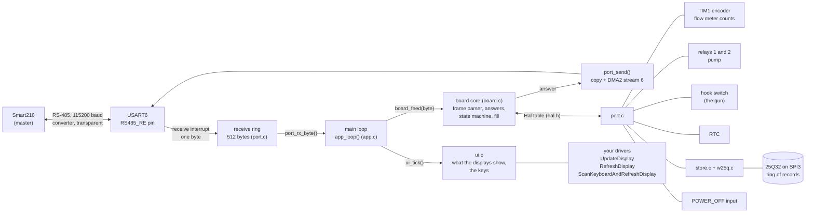
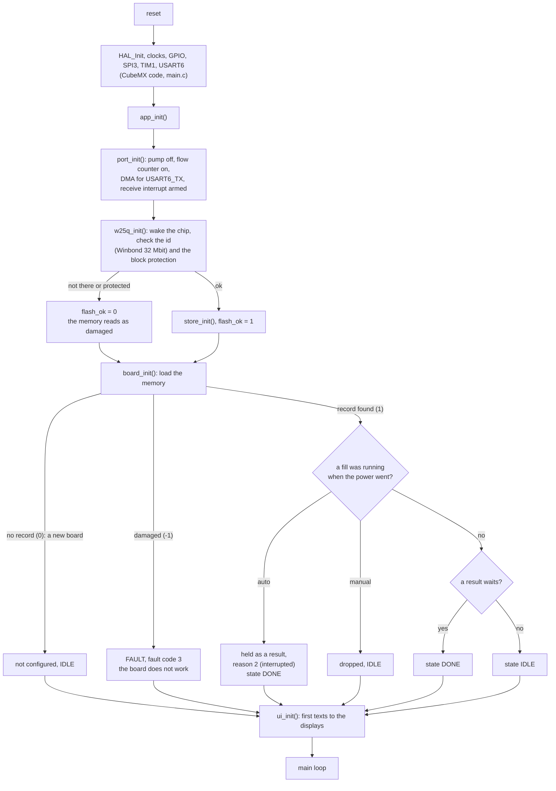
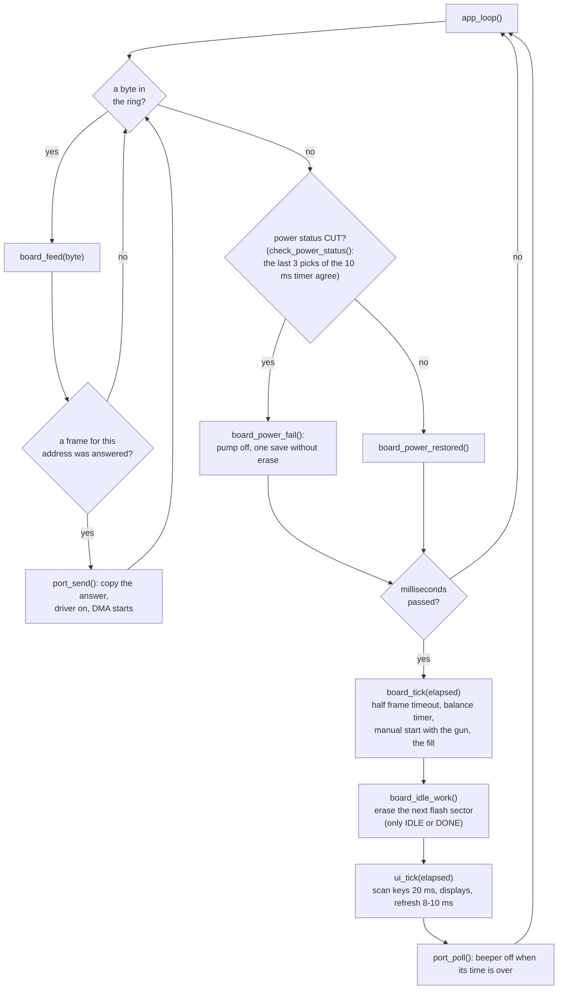
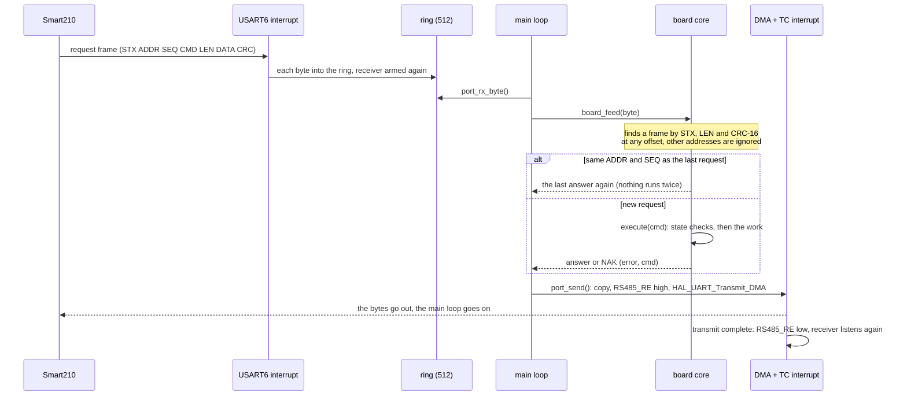
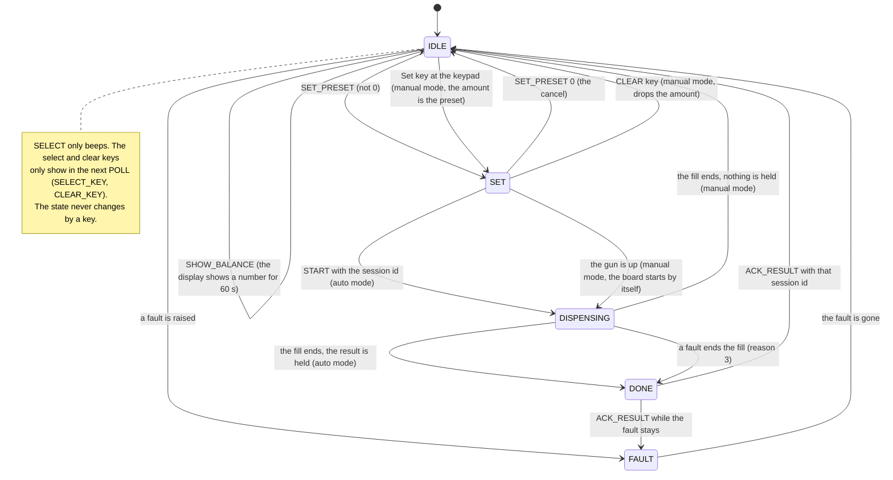
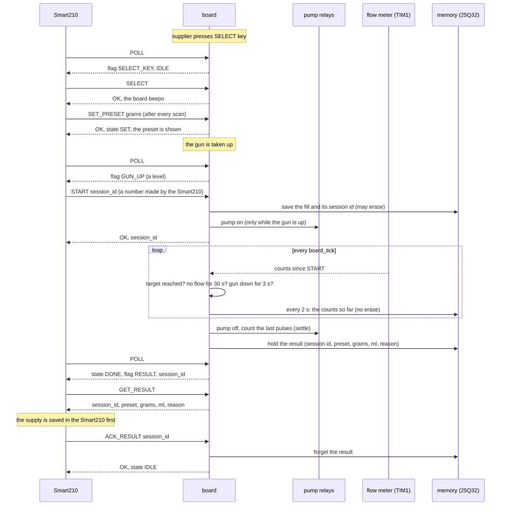
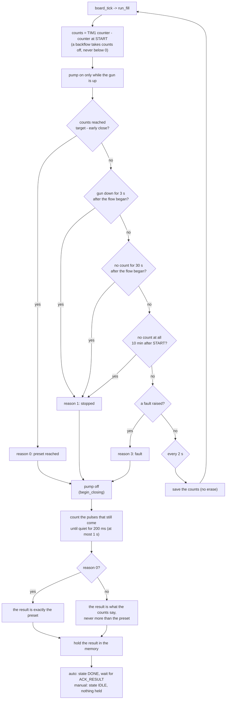
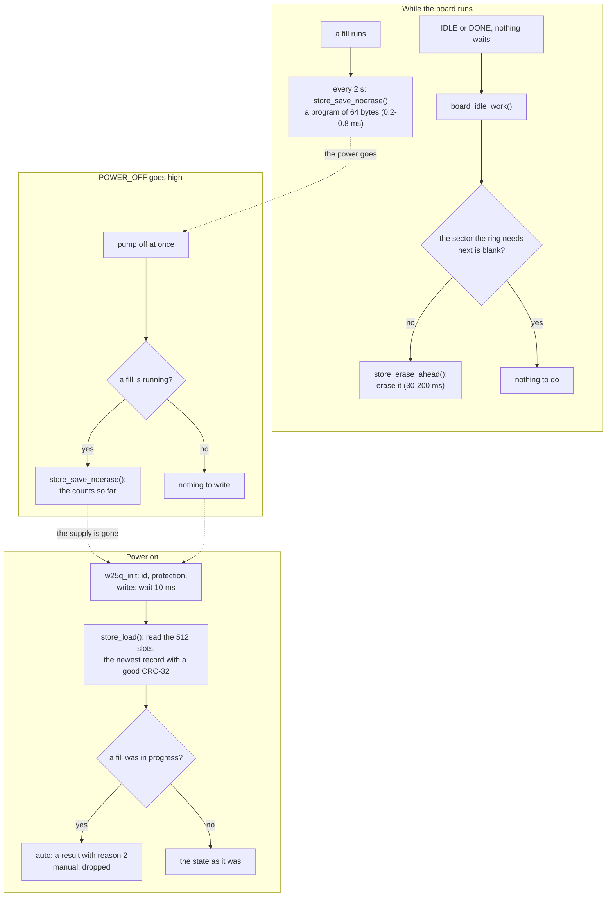
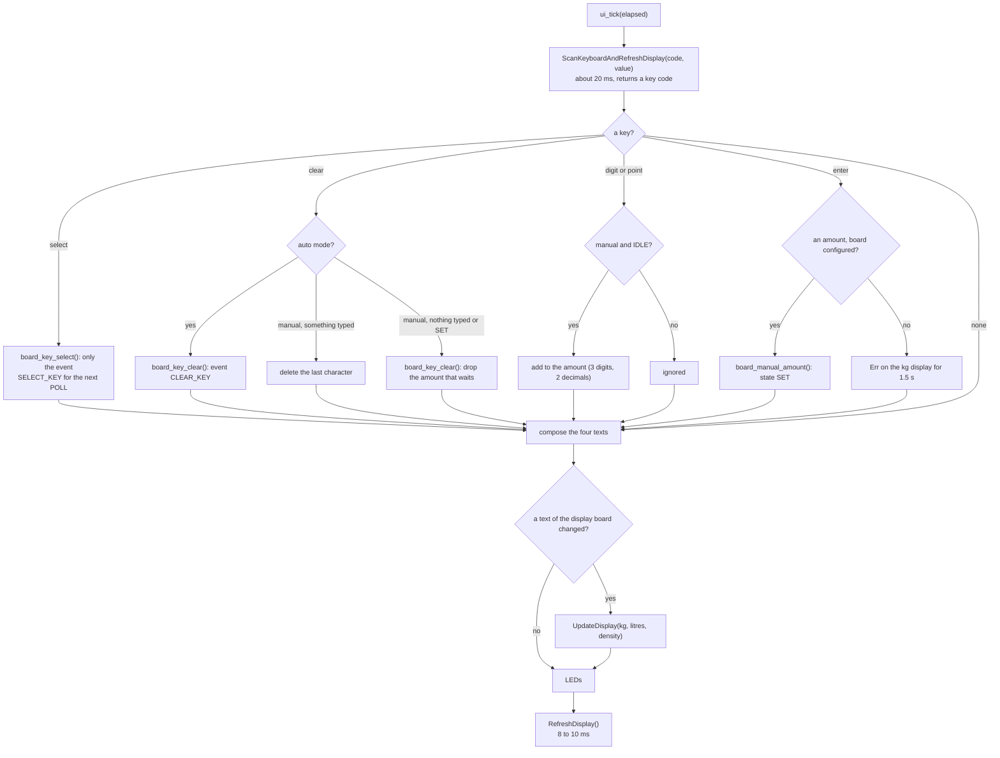
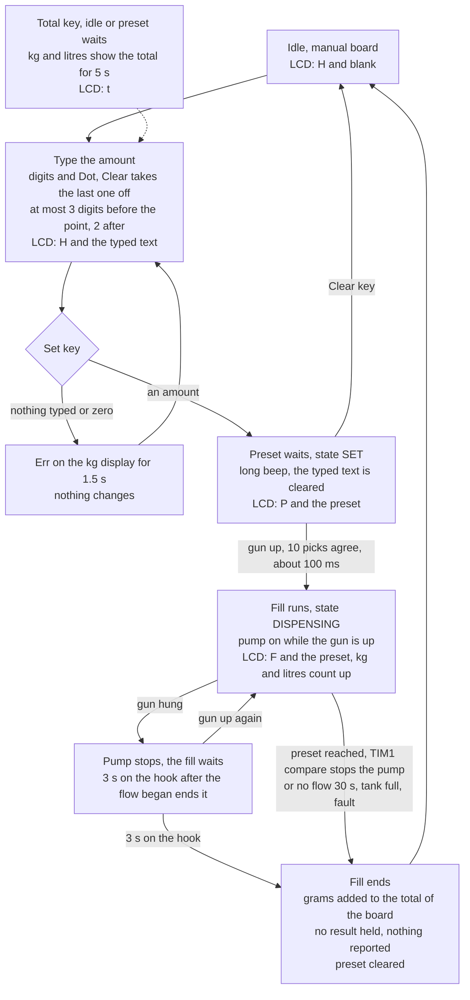

# Nozzle board firmware: workflow diagrams

How the firmware in `Core/Src` works, from the start of the program to a fill and a power cut. The diagrams follow the code (firmware 1.1, protocol v0.4 with SHOW_BALANCE and the session id of START). The protocol itself is in [../PROTOCOL.md](../PROTOCOL.md), the files in [README.md](README.md).

## 1. The parts and who calls whom

## 2. Start-up

## 3. One pass of the main loop

## 4. A request and its answer

## 5. The states of the nozzle

## 6. A fill, auto mode

## 7. How a fill ends

## 8. The memory over a power cut

A record that a power cut interrupts has a wrong CRC and is ignored, so the previous record is the state. The newest record is never in the sector that is erased ahead.

## 9. A pass of the user interface

| Display | Shows |
|---|---|
| kg (6 digits) | 0.00 idle, the balance (SHOW_BALANCE), the preset (SET), the kg so far, the kg of the result, `Err` |
| litres (6 digits) | 0.00, `bAL` while a balance shows, the litres so far, the fault code |
| density (4 digits) | the density of the config, `0.830`; `----` when never configured |
| keyboard board (8 digits) | the amount being typed (manual), the preset while SET and DISPENSING |

## 10. A fill, manual mode (the amount typed on the keyboard)

The supplier does everything at the dispenser; the Smart210 only watches. The first digit of the keyboard's LCD (`code`) shows where the board is: `H` idle, `P` a preset waits, `F` a fill runs (`t` while the Total key shows the total, `E` for a fault); the other seven digits (`value`) show the amount.

- No key does anything while a fill runs. There is no cancel: the supplier stops by hanging the gun.
- A power cut in the middle of a manual fill drops the fill (nothing is reported), but what it dispensed up to the last save is added to the total.
- The Function, Next and Prev keys do nothing in manual mode.
## 11. Where the time goes in one pass of the main loop

| Part | Takes | Notes |
|---|---|---|
| receive ring and `board_feed` | microseconds | the interrupt only stores bytes |
| `port_send` | microseconds | the DMA sends the bytes in the background (up to 7 ms on the line) |
| `board_tick`, the fill | microseconds | pump stop decided here |
| `board_idle_work` | 0, or 30-200 ms once in 64 saves | only in IDLE or DONE, never while the supply goes |
| `ScanKeyboardAndRefreshDisplay` | about 20 ms | blocks |
| `RefreshDisplay` | 8 to 10 ms | blocks |
| **one pass** | **about 30 ms** | an answer can be up to 20 ms late; POWER_OFF and the gun switch are picked by a 10 ms timer and looked at once per pass: a cut is seen within about 60 ms, the gun within about 130 ms; the pump stop of a fill is the TIM1 compare interrupt (see README) |
